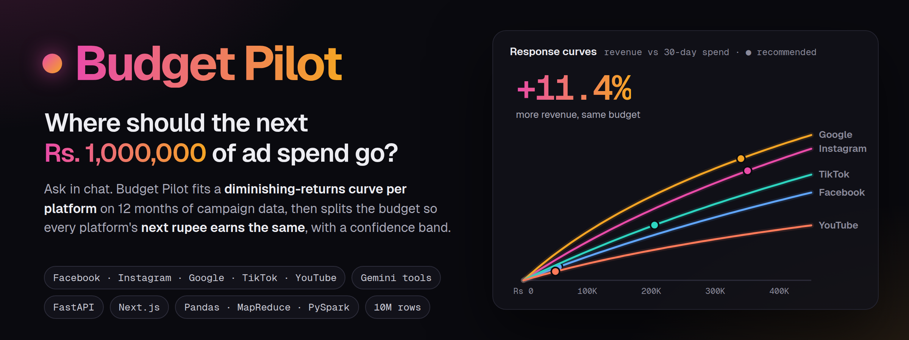
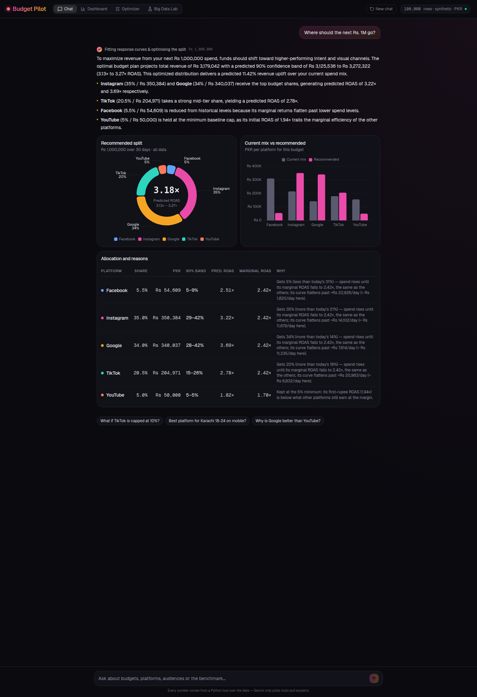
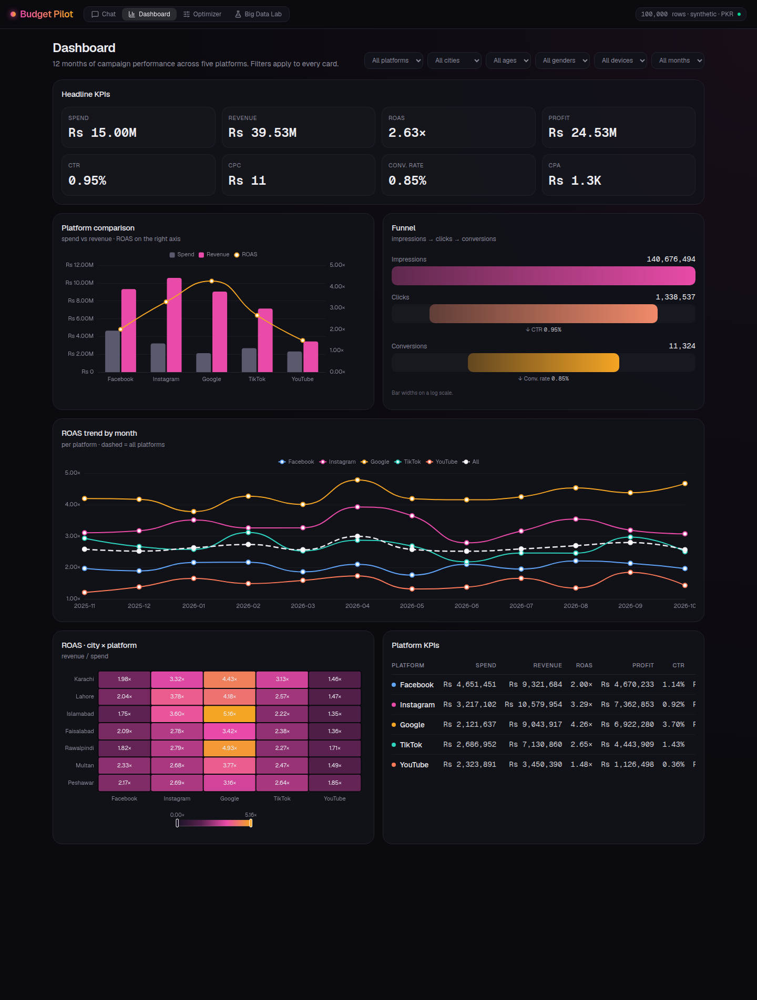
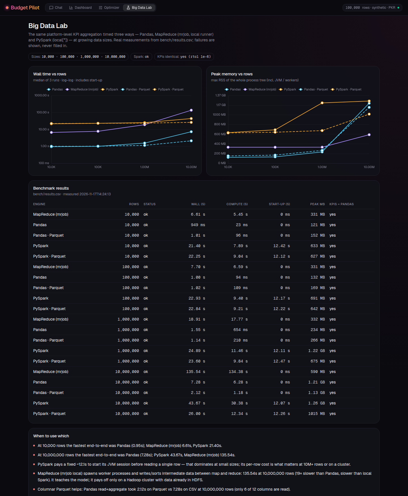

# Budget Pilot

<p align="center">
  
</p>

**Ask in chat where the next Rs. 1,000,000 of ad spend should go. Budget Pilot fits a diminishing-returns curve for Facebook, Instagram, Google, TikTok and YouTube, then moves money until every platform's next rupee earns the same: +11.4% revenue from the same budget, with a 90% confidence band.**

## ▶️ Launch video (48 s)

<!--
  BRAG VIDEO SLOT: inline player via a GitHub issue upload.
  1. Open an issue in this repo (or any comment box), drag brag-output/brag.mp4 into it and wait for the upload.
  2. Copy the generated link: https://github.com/user-attachments/assets/<id>
  3. Replace the placeholder URL below with it, keeping it on its own line with blank lines around it.
     GitHub then renders an inline video player (the poster frame brag.jpg is already baked into frame 0).
  4. Delete the "coming soon" line.
-->

https://github.com/user-attachments/assets/REPLACE-WITH-BRAG-VIDEO-ID

> 🎬 *Launch video coming soon:* one Rs 1,000,000 budget, five platforms, the curves that flatten, and the optimizer moving money until every platform's next rupee earns 2.42×.

Built for the Big Data Analytics course. The chat runs on Gemini function calling, but **every number comes from Python tools** over 12 months of campaign data (5 platforms · 7 cities · 40 campaigns). The same KPI job is benchmarked in **Pandas, MapReduce and PySpark up to 10,000,000 rows**, with identical results.

<details>
<summary><b>Screenshots</b> (Chat · Dashboard · Optimizer · Big Data Lab)</summary>



| Dashboard | Optimizer | Big Data Lab |
|---|---|---|
|  |  |  |

</details>

## The problem

Management asks one question: **"Where should we spend the next Rs. 1,000,000?"** The usual answer is to repeat last month's split, or to move money to the platform with the best average ROAS. Both are wrong for the same reason: **returns diminish**. The 300,000th rupee on a platform earns much less than the first. The right question is which platform earns the most from its **next** rupee (marginal ROAS), and how far you can push each one before it flattens.

Budget Pilot answers that from the data:

- **Chat** (home): "What if TikTok is capped at 10%?" or "Best platform for Karachi 18-24 on mobile?" Gemini picks a tool, and the answer comes back with inline charts and tables.
- **Dashboard**: KPI cards, platform comparison, ROAS trend by month, a city × platform heatmap and the funnel. Every view is filterable.
- **Optimizer**: budget, min/max sliders per platform and an audience filter. Shows an animated allocation donut, the response curve per platform (recommended ● and current ○ spend marked), current vs recommended, and a reason per platform.
- **Big Data Lab**: measured wall time and memory for Pandas, MapReduce and Spark at growing sizes, plus an auto-written "when to use which".

## How it decides (in plain words)

Budget Pilot doesn't ask "which platform has the best ROAS?" It asks **"which platform earns the most from its *next* rupee?"** and keeps moving money there until no move helps any more.

1. **Learn each platform's curve.** From 365 days of daily spend and revenue, it fits `revenue = a · log(1 + spend / b)` per platform. Every curve rises quickly, then flattens: the 300,000th rupee earns less than the first.
2. **Read the next-rupee return.** The curve's slope at a spend level is the **marginal ROAS**, `a / (b + spend)`: what one more rupee returns there.
3. **Move money until the platforms balance.** Rupees go from platforms with a low next-rupee return to platforms with a high one, within each platform's min/max caps (default 5–60%). It stops when every uncapped platform's next rupee earns the same.
4. **Score it and show the uncertainty.** The same curves score today's split and an equal split. 100 bootstrap refits over resampled days give a 90% band.

**Indicators it uses**

| Indicator | Where it comes from | What it drives |
|---|---|---|
| Daily **spend** and **revenue** per platform | 12 months of campaign rows, summed per day | The fitted response curve (`a`, `b`) |
| **ROAS** = revenue / spend | `engine/kpis.py` | First-rupee return `a/b`; scoring today's split vs the plan |
| **Marginal ROAS** = `a / (b + spend)` | Slope of the fitted curve | *The* allocation signal: equalised across platforms |
| **Audience ROAS ratio** (city · age · gender · device) | ROAS of that audience on a platform ÷ the platform's overall ROAS | Raises or lowers each curve for a target audience (e.g. Karachi · 18–24 · mobile) |
| **Min / max share** per platform | Your sliders or chat ("cap TikTok at 10%") | Hard limits on the split |
| CTR · CPC · CPM · CVR · CPA · AOV · profit | `engine/kpis.py` | Shown on the Dashboard and in chat to explain *why* a platform converts |

**Worked example (Rs 1,000,000 over 30 days, the app's default dataset)**

| Platform | Today's share | Next-rupee return today | Recommended share | Next-rupee return after |
|---|---:|---:|---:|---:|
| Google | 14.1% | 3.72× | **34.0%** | 2.42× |
| Instagram | 21.4% | 2.93× | **35.0%** | 2.42× |
| TikTok | 17.9% | 2.50× | **20.5%** | 2.42× |
| Facebook | 31.0% | 1.80× | **5.5%** | 2.42× |
| YouTube | 15.5% | 1.36× | **5.0%** (min cap) | 1.70× |

Result: predicted ROAS goes from **2.85× to 3.18×**, i.e. **+11.4% revenue from the same budget** (90% band +9.4% to +14.6%). YouTube stays at its 5% minimum because even its first rupee (1.94×) earns less than the 2.42× the others still earn at the margin. Ask "What if TikTok is capped at 10%?" and it re-routes to Instagram and Google, costing only 0.7%. For Karachi · 18–24 · mobile the split flips to **TikTok 52%**.

## Architecture

```mermaid
flowchart LR
  subgraph Data
    G[data/generate.py<br/>vectorised NumPy, chunked] -->|Parquet + CSV| P[(data/ads_*.parquet)]
  end
  subgraph Engine["engine/ (pure Python)"]
    K[kpis.py<br/>CTR · CPC · CPA · CVR · ROAS · profit]
    O[optimizer.py<br/>curve_fit a·log(1+s/b)<br/>water-filling + bootstrap]
  end
  subgraph Bench["bench/"]
    B1[pandas_job.py] & B2[mr_job.py · mrjob local] & B3[spark_job.py · local*]
    R[run_all.py<br/>3 runs · median · peak RSS · agree?] --> CSV[(results.csv)] --> TR[to_readme.py]
  end
  subgraph Backend["backend/ FastAPI"]
    T[tools.py<br/>get_kpis · optimize_budget<br/>compare_scenarios · get_benchmark]
    A[agent.py<br/>function-calling loop] --> L[llm.py<br/>Gemini client · retry · rate gate]
    A --> T
  end
  subgraph Frontend["frontend/ Next.js + ECharts"]
    C[Chat] & D[Dashboard] & OP[Optimizer] & LAB[Big Data Lab]
  end
  P --> T
  K --> T
  O --> T
  CSV --> T
  P --> B1 & B2 & B3
  B1 & B2 & B3 --> R
  C -- SSE /api/chat --> A
  D & OP & LAB -- /api/tool/* --> T
  L <--> GEM[(Gemini API)]
```

**Golden rule (carried over from Need Map Chat): the LLM never computes numbers.** Gemini only routes the question to a tool and explains what the tool returned. The tools return `{summary, charts}`; the summary goes back to Gemini and the charts are drawn under the answer.

## Data schema

12 months of campaign data in PKR, 2025-11-01 → 2026-10-31, at any size from 10K to 10M rows (`data/generate.py --rows 10000|100000|1000000|10000000`).

| Column | Type | Notes |
|---|---|---|
| `date` | date | 365 days |
| `campaign` | category | 40 campaigns, e.g. "Eid Sale – Retargeting", "Winter Launch – Awareness", "11.11 Mega Sale – Conversions" |
| `platform` | category | Facebook, Instagram, Google, TikTok, YouTube |
| `impressions`, `clicks`, `conversions` | int | clicks ~ Binomial(impressions, CTR); conversions ~ Binomial(clicks, p) |
| `spend`, `revenue` | float (PKR) | |
| `age` | category | 18-24, 25-34, 35-44, 45-54, 55+ |
| `gender` | category | M, F |
| `city` | category | Lahore, Karachi, Islamabad, Rawalpindi, Faisalabad, Multan, Peshawar |
| `device` | category | mobile, desktop, tablet |

What's in the data:

- **Per-platform economics**: CPM, CTR and AOV differ by platform. Google has expensive clicks but high intent and a high conversion rate. YouTube has cheap impressions and a low conversion rate. TikTok has cheap clicks and a young, mobile audience.
- **Audience skew and value**: age, gender, device and city mix differ by platform. So does how well each segment converts (e.g. TikTok 18-24 mobile, Google desktop, Islamabad search).
- **Seasonality**: 11.11, White/Black Friday, 12.12, Ramadan → Eid ul Fitr, Eid ul Adha and 14 August spike both spend and demand.
- **Diminishing returns**: each platform's daily revenue flattens as its spend grows. That is the pattern the optimizer learns. Within a day, revenue differs by campaign objective (retargeting converts best, awareness worst) and by audience segment.
- **Scales to 10M rows without blowing RAM**: the dataset is built in chunks of whole platform-days and streamed to Parquet with dictionary-encoded strings. More rows means a finer breakdown of the same business, so daily totals don't depend on `--rows`.

## KPI formulas (`engine/kpis.py`)

| KPI | Formula |
|---|---|
| CTR | clicks / impressions |
| CPC | spend / clicks |
| CPM | spend / impressions × 1000 |
| Conversion rate (CVR) | conversions / clicks |
| CPA | spend / conversions |
| ROAS | revenue / spend |
| Profit | revenue − spend (media profit; product margin not modelled) |
| AOV | revenue / conversions |

All ratios use safe division (0 when the denominator is 0), so the output never contains inf or NaN. You can group by platform, campaign, city, age, gender, device or month, and every filter combines with every other.

## Optimizer method (`engine/optimizer.py`)

1. **Response curve per platform.** `scipy.optimize.curve_fit` fits `revenue_day = a · log(1 + spend_day / b)` on daily spend vs revenue. `a/b` is the ROAS of the first rupee, `a/(b+s)` is the marginal ROAS at daily spend `s`, and `b` is where the curve starts to flatten.
2. **Horizon.** The budget is spent over H days (default 30 ≈ one month, about the historical pace). Spending `x` on platform p predicts `H · a_p · log(1 + x/(H·b_p))`.
3. **Allocation.** Maximise total predicted revenue subject to `Σx = budget` and per-platform min/max % (defaults 5% and 60%, adjustable). The objective is concave and separable, so the optimum **equalises marginal ROAS** across platforms that are not at a cap (KKT water-filling). λ is found by bisection, giving `x_p = clip(H·(a_p/λ − b_p), min_p, max_p)`. This is exact, sums to the budget to the rupee, and is fast enough to run inside a bootstrap.
4. **Audience filter** (e.g. city=Karachi, age 18-24, mobile). The curve shape comes from the whole platform. Filtered daily data is too thin to fit and would be extrapolated far outside its range. The curve height is rescaled by `k = ROAS(audience on p) / ROAS(all on p)`, i.e. how much better or worse that audience converts on that platform.
5. **Baselines.** The same curves score the **current mix** (historical spend shares) and an **equal split**, which gives the uplift.
6. **Uncertainty.** A bootstrap resamples days with replacement, refits every curve and re-optimises, 100 times. The output is a 90% band (5th–95th percentile) for revenue, ROAS, uplift and each platform's share.
7. **Plain-language reason per platform.** Each reason is generated from the numbers: share vs today's share, the marginal ROAS where it stops, where its curve flattens, and whether it hit a cap.

On the app's default dataset the recommended split for Rs 1,000,000 over 30 days moves money from Facebook and YouTube to Instagram and Google: **+11.4% revenue vs the current mix** (90% band +9.4% to +14.6%), and +9.2% vs an equal split. See the worked example under [How it decides](#how-it-decides-in-plain-words).

## Big Data benchmark (`bench/`)

The same **platform-level KPI aggregation** (sum impressions, clicks, spend, conversions and revenue by platform, then compute KPIs with the shared `engine.kpis.finalize`) is run three ways:

1. **Pandas**: `read_csv`/`read_parquet` → `groupby().sum()`.
2. **MapReduce** with `mrjob`, **local runner** (real multi-process map → sort → reduce). The mapper emits `(platform, [impressions, clicks, spend, conversions, revenue])`, and a combiner and reducer sum them.
3. **PySpark** `local[*]`: `groupBy("platform").agg(sum…)`.

Pandas and Spark are also timed on Parquet. `bench/run_all.py` runs every size × engine 3 times, each in a fresh subprocess:

- **Wall time** is measured from launch to exit and includes start-up, as a user would feel it. The job's own compute time and Spark's session start-up time are recorded too.
- **Peak memory** is the sampled RSS of the whole process tree, including the JVM and mrjob workers.
- **Agreement**: every engine's KPIs are asserted equal to Pandas at rtol 1e-6.
- **Failures**: a failure or timeout is recorded as `failed`/`timeout`, never filled in.

<!-- BENCH:START -->
| Engine | 10,000 rows | 100,000 rows | 1,000,000 rows | 10,000,000 rows |
|---|---:|---:|---:|---:|
| Pandas (CSV) | 0.95 s · 121 MB | 1.00 s · 132 MB | 1.55 s · 234 MB | 7.28 s · 1241 MB |
| MapReduce · mrjob local (CSV) | 6.61 s · 331 MB | 7.70 s · 331 MB | 18.91 s · 332 MB | 135.54 s · 590 MB |
| PySpark local[*] (CSV) | 21.40 s · 632 MB | 22.93 s · 691 MB | 24.89 s · 1248 MB | 43.67 s · 1286 MB |
| Pandas (Parquet) | 1.01 s · 152 MB | 1.02 s · 168 MB | 1.14 s · 266 MB | 2.12 s · 1156 MB |
| PySpark local[*] (Parquet) | 22.25 s · 627 MB | 22.84 s · 642 MB | 23.60 s · 675 MB | 26.00 s · 1015 MB |

Median wall time of 3 runs (includes interpreter / JVM start-up) · peak RSS of the whole process tree · all engines produced identical KPIs (rtol 1e-6) · measured 2026-11-17T14:24:13 on this machine. Raw: `bench/results.csv`.
<!-- BENCH:END -->

**What the numbers show**

- **All three engines produce identical KPIs** at every size, from 10K to 10M rows (checked to rtol 1e-6 on every run).
- **Spark's cost barely grows with data.** On Parquet, 1,000× more rows (10K → 10M) took Spark from 22.3 s to 26.0 s. The ~12 s it spends starting the JVM is a fixed cost, and its per-row cost is what scales across a cluster.
- **Parquet pays off at scale.** At 10M rows, columnar Parquet makes Pandas 3.4× faster (7.3 s → 2.1 s) and Spark 1.7× faster (43.7 s → 26.0 s), because only the needed columns are read.
- **MapReduce streams with the smallest footprint** (590 MB at 10M rows vs about 1.2 GB for Pandas and Spark). It writes intermediate data to disk between map and reduce, which is exactly the trade-off Hadoop makes for data larger than memory.
- **On one machine, Pandas on Parquet is the fastest end to end** (2.1 s at 10M rows). Spark is the engine to reach for once the data outgrows one machine's RAM.

Reproduce: `make bench-small` (10K, 100K) or `make bench` (adds 1M and 10M; `make bench MAX_ROWS=1000000` skips 10M).

## Setup

Everything lives in the conda env **`budget-pilot`** (Python 3.11, OpenJDK 17 for Spark, Node 22 for the frontend). Nothing is installed system-wide.

```bash
make setup              # conda env from environment.yml + npm install in frontend/ (+ .env from .env.example)
# put your key in .env:  GEMINI_API_KEY=...   (AI Studio → API keys)
make data               # 10K (+CSV) and 100K rows
make test               # pytest (KPIs, optimizer constraints, engines agree, API) + eslint
make app                # backend http://localhost:8000 + frontend http://localhost:3000
make bench              # full benchmark 10K → 10M, then refreshes the table above
make shots              # headless screenshots → docs/screens/ (system Chrome)
```

Without `make`: `conda env create -f environment.yml`, then prefix each command with `conda run -n budget-pilot`, e.g. `conda run -n budget-pilot python data/generate.py --rows 100000`.

| Env var (`.env`) | Default | Meaning |
|---|---|---|
| `GEMINI_API_KEY` | — | required for chat. Without it, chat shows an "Add GEMINI_API_KEY" banner and the other pages still work |
| `GEMINI_CHAT_MODEL` | `gemini-3.6-flash` | any Gemini model with function calling |
| `GEMINI_RPM` | 10 | client-side requests/minute cap |
| `MOCK_CHAT` | 0 | 1 = offline keyword router instead of Gemini (tests, demos without a key) |
| `BP_DATASET` | `100k` | which `data/ads_*.parquet` the app loads |
| `N_BOOT` | 100 | optimizer bootstrap iterations |

## Project layout

```
data/generate.py          dataset builder, 10K → 10M rows (chunked → Parquet; CSV for ≤10K)
engine/kpis.py            KPI formulas, filters, group-by
engine/optimizer.py       curve fitting, constrained allocation, bootstrap, reasons
bench/                    pandas_job.py · mr_job.py · spark_job.py · run_all.py · to_readme.py · results.csv
backend/app/              FastAPI: main.py · tools.py · agent.py · llm.py · store.py · config.py · schemas.py
frontend/src/             Next.js app: Chat · Dashboard · Optimizer · Big Data Lab; charts/ (ECharts)
tests/                    pytest suite
docs/                     DEMO_SCRIPT.md · DECISIONS.md · REUSED.md · screens/ · media/banner.png
```

## Roadmap

- **Live ad-platform connectors:** pull Meta, Google Ads and TikTok exports straight into the same schema.
- **Full media-mix modelling:** adstock (carry-over), cross-platform lift (YouTube awareness → Google search) and per-objective saturation, e.g. a Bayesian MMM.
- **Experiment designer:** suggest geo-holdout tests that confirm each recommended shift before the full budget moves.
- **Cluster scale:** run the same Spark job on Dataproc / EMR and the same mrjob code on Hadoop Streaming over HDFS.
- **Pacing:** day-parting and weekly budget shifts within the month.
- **Full P&L:** product margins on top of media profit (revenue − ad spend).
