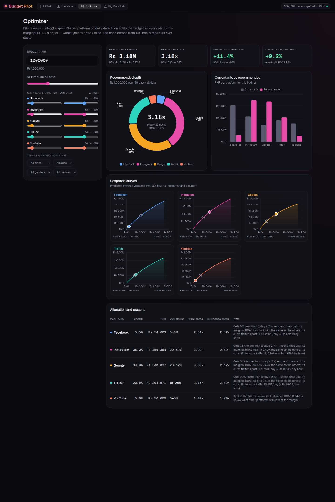

# Budget Pilot

**Ask in chat where the next Rs. 1,000,000 of ad spend should go. Budget Pilot fits a diminishing-returns curve per platform and recommends a split across Facebook, Instagram, Google, TikTok and YouTube, with a confidence band.**

Big Data Analytics course project. The chat runs on Gemini function calling. Every number comes from Python tools over 12 months of campaign data, and the same KPI aggregation is benchmarked in Pandas, MapReduce and PySpark.

## Demo videos

### 🎬 Screen recording (3 min walkthrough)

<!-- TODO: replace with the real link once recorded (script: docs/DEMO_SCRIPT.md).
     YouTube:  [](https://www.youtube.com/watch?v=VIDEO_ID)
     GitHub:   drag the .mp4 into this README in the GitHub web editor; it becomes a playable video. -->

[](https://www.youtube.com/watch?v=VIDEO_ID_DEMO)

> **Placeholder:** 3-minute screen recording coming soon. It covers the Rs. 1M question, a TikTok cap, Karachi 18-24 mobile, the Dashboard, Optimizer sliders and the Big Data Lab.

### ⚡ Brag video (45 s)

<!-- TODO: replace with the real link once rendered (shot list: bottom of docs/DEMO_SCRIPT.md). -->

[](https://www.youtube.com/watch?v=VIDEO_ID_BRAG)

> **Placeholder:** 45-second launch-style video coming soon.

## Screenshots


| Dashboard | Optimizer | Big Data Lab |
|---|---|---|
|  |  |  |

## The problem

Management asks one question: **"Where should we spend the next Rs. 1,000,000?"** The usual answer is to repeat last month's split, or to move money to the platform with the best average ROAS. Both are wrong for the same reason: **returns diminish**. The 300,000th rupee on a platform earns much less than the first. The right question is which platform earns the most from its **next** rupee (marginal ROAS), and how far you can push each one before it flattens.

Budget Pilot answers that from the data:

- **Chat** (home): "What if TikTok is capped at 10%?" or "Best platform for Karachi 18-24 on mobile?" Gemini picks a tool, and the answer comes back with inline charts and tables.
- **Dashboard**: KPI cards, platform comparison, ROAS trend by month, a city × platform heatmap and the funnel. Every view is filterable.
- **Optimizer**: budget, min/max sliders per platform and an audience filter. Shows an animated allocation donut, the response curve per platform (recommended ● and current ○ spend marked), current vs recommended, and a reason per platform.
- **Big Data Lab**: measured wall time and memory for Pandas, MapReduce and Spark at growing sizes, plus an auto-written "when to use which".

## Architecture

```mermaid
flowchart LR
  subgraph Data
    G[data/generate.py<br/>vectorised NumPy, chunked] -->|Parquet + CSV| P[(data/ads_*.parquet)]
  end
  subgraph Engine["engine/ (pure Python)"]
    K[kpis.py<br/>CTR · CPC · CPA · CVR · ROAS · profit]
    O[optimizer.py<br/>curve_fit a·log(1+s/b)<br/>water-filling + bootstrap]
  end
  subgraph Bench["bench/"]
    B1[pandas_job.py] & B2[mr_job.py · mrjob local] & B3[spark_job.py · local*]
    R[run_all.py<br/>3 runs · median · peak RSS · agree?] --> CSV[(results.csv)] --> TR[to_readme.py]
  end
  subgraph Backend["backend/ FastAPI"]
    T[tools.py<br/>get_kpis · optimize_budget<br/>compare_scenarios · get_benchmark]
    A[agent.py<br/>function-calling loop] --> L[llm.py<br/>Gemini client · retry · rate gate]
    A --> T
  end
  subgraph Frontend["frontend/ Next.js + ECharts"]
    C[Chat] & D[Dashboard] & OP[Optimizer] & LAB[Big Data Lab]
  end
  P --> T
  K --> T
  O --> T
  CSV --> T
  P --> B1 & B2 & B3
  B1 & B2 & B3 --> R
  C -- SSE /api/chat --> A
  D & OP & LAB -- /api/tool/* --> T
  L <--> GEM[(Gemini API)]
```

**Golden rule (carried over from Need Map Chat): the LLM never computes numbers.** Gemini only routes the question to a tool and explains what the tool returned. The tools return `{summary, charts}`; the summary goes back to Gemini and the charts are drawn under the answer.

## Data schema

Synthetic, realistic, PKR, 2025-11-01 → 2026-10-31 (`data/generate.py --rows 10000|100000|1000000|10000000`).

| Column | Type | Notes |
|---|---|---|
| `date` | date | 365 days |
| `campaign` | category | 40 campaigns, e.g. "Eid Sale – Retargeting", "Winter Launch – Awareness", "11.11 Mega Sale – Conversions" |
| `platform` | category | Facebook, Instagram, Google, TikTok, YouTube |
| `impressions`, `clicks`, `conversions` | int | clicks ~ Binomial(impressions, CTR); conversions ~ Binomial(clicks, p) |
| `spend`, `revenue` | float (PKR) | |
| `age` | category | 18-24, 25-34, 35-44, 45-54, 55+ |
| `gender` | category | M, F |
| `city` | category | Lahore, Karachi, Islamabad, Rawalpindi, Faisalabad, Multan, Peshawar |
| `device` | category | mobile, desktop, tablet |

How the data is made realistic rather than uniform random:

- **Per-platform economics**: CPM, CTR and AOV differ by platform. Google has expensive clicks but high intent and high conversion rate. YouTube has cheap impressions and a low conversion rate. TikTok has cheap clicks and a young, mobile audience.
- **Audience skew and value**: age, gender, device and city mix differ by platform. So does how well each segment converts (e.g. TikTok 18-24 mobile, Google desktop, Islamabad search).
- **Seasonality**: 11.11, White/Black Friday, 12.12, Ramadan → Eid ul Fitr, Eid ul Adha and 14 August spike both spend and demand.
- **Diminishing returns**: expected revenue per platform-day is `a_p · log(1 + spend/b_p) · demand(day)`. Revenue is then split across rows by campaign objective (retargeting converts best, awareness worst) and by segment value.
- **Scales without blowing RAM**: rows are generated in chunks of whole platform-days and streamed to Parquet with dictionary-encoded strings. More rows means a finer breakdown of the same business, so daily totals don't depend on `--rows`.

## KPI formulas (`engine/kpis.py`)

| KPI | Formula |
|---|---|
| CTR | clicks / impressions |
| CPC | spend / clicks |
| CPM | spend / impressions × 1000 |
| Conversion rate (CVR) | conversions / clicks |
| CPA | spend / conversions |
| ROAS | revenue / spend |
| Profit | revenue − spend (media profit; product margin not modelled) |
| AOV | revenue / conversions |

All ratios use safe division (0 when the denominator is 0), so the output never contains inf or NaN. You can group by platform, campaign, city, age, gender, device or month, and every filter combines with every other.

## Optimizer method (`engine/optimizer.py`)

1. **Response curve per platform.** `scipy.optimize.curve_fit` fits `revenue_day = a · log(1 + spend_day / b)` on daily spend vs revenue. `a/b` is the ROAS of the first rupee, `a/(b+s)` is the marginal ROAS at daily spend `s`, and `b` is where the curve starts to flatten.
2. **Horizon.** The budget is spent over H days (default 30 ≈ one month, about the historical pace). Spending `x` on platform p predicts `H · a_p · log(1 + x/(H·b_p))`.
3. **Allocation.** Maximise total predicted revenue subject to `Σx = budget` and per-platform min/max % (defaults 5% and 60%, adjustable). The objective is concave and separable, so the optimum **equalises marginal ROAS** across platforms that are not at a cap (KKT water-filling). λ is found by bisection, giving `x_p = clip(H·(a_p/λ − b_p), min_p, max_p)`. This is exact, sums to the budget to the rupee, and is fast enough to run inside a bootstrap.
4. **Audience filter** (e.g. city=Karachi, age 18-24, mobile). The curve shape comes from the whole platform. Filtered daily data is too thin to fit and would be extrapolated far outside its range. The curve height is rescaled by `k = ROAS(audience on p) / ROAS(all on p)`, i.e. how much better or worse that audience converts on that platform.
5. **Baselines.** The same curves score the **current mix** (historical spend shares) and an **equal split**, which gives the uplift.
6. **Uncertainty.** A bootstrap resamples days with replacement, refits every curve and re-optimises, 100 times. The output is a 90% band (5th–95th percentile) for revenue, ROAS, uplift and each platform's share.
7. **Plain-language reason per platform.** Each reason is generated from the numbers: share vs today's share, the marginal ROAS where it stops, where its curve flattens, and whether it hit a cap.

On the 100K dataset the recommended split for Rs 1,000,000 over 30 days shifts money from Facebook and YouTube to Instagram and Google. It predicts about **+11% revenue vs the current mix** (90% band: roughly +9% to +15%). Run the app to see the current numbers.

## Big Data benchmark (`bench/`)

The same **platform-level KPI aggregation** (sum impressions, clicks, spend, conversions and revenue by platform, then compute KPIs with the shared `engine.kpis.finalize`) is run three ways:

1. **Pandas**: `read_csv`/`read_parquet` → `groupby().sum()`.
2. **MapReduce** with `mrjob`, **local runner** (real multi-process map → sort → reduce). The mapper emits `(platform, [impressions, clicks, spend, conversions, revenue])`, and a combiner and reducer sum them.
3. **PySpark** `local[*]`: `groupBy("platform").agg(sum…)`.

Pandas and Spark are also timed on Parquet. `bench/run_all.py` runs every size × engine 3 times, each in a fresh subprocess:

- **Wall time** is measured from launch to exit and includes start-up, as a user would feel it. The job's own compute time and Spark's session start-up time are recorded too.
- **Peak memory** is the sampled RSS of the whole process tree, including the JVM and mrjob workers.
- **Agreement**: every engine's KPIs are asserted equal to Pandas at rtol 1e-6.
- **Failures**: a failure or timeout is recorded as `failed`/`timeout`, never filled in.

<!-- BENCH:START -->
| Engine | 10,000 rows | 100,000 rows |
|---|---:|---:|
| Pandas (CSV) | 0.95 s · 122 MB | 1.01 s · 130 MB |
| MapReduce · mrjob local (CSV) | 6.76 s · 332 MB | 7.64 s · 332 MB |
| PySpark local[*] (CSV) | 21.93 s · 662 MB | 22.70 s · 827 MB |
| Pandas (Parquet) | 1.01 s · 152 MB | 1.01 s · 170 MB |
| PySpark local[*] (Parquet) | 21.93 s · 657 MB | 21.96 s · 642 MB |

Median wall time of 3 runs (includes interpreter / JVM start-up) · peak RSS of the whole process tree · all engines produced identical KPIs (rtol 1e-6) · measured 2026-11-17T05:30:49 on this machine. Raw: `bench/results.csv`.
<!-- BENCH:END -->

Reproduce: `make bench-small` (10K, 100K) or `make bench` (adds 1M and 10M; `make bench MAX_ROWS=1000000` skips 10M).

## Setup

Everything lives in the conda env **`budget-pilot`** (Python 3.11, OpenJDK 17 for Spark, Node 22 for the frontend). Nothing is installed system-wide.

```bash
make setup              # conda env from environment.yml + npm install in frontend/ (+ .env from .env.example)
# put your key in .env:  GEMINI_API_KEY=...   (AI Studio → API keys)
make data               # 10K (+CSV) and 100K rows
make test               # pytest (KPIs, optimizer constraints, engines agree, API) + eslint
make app                # backend http://localhost:8000 + frontend http://localhost:3000
make bench              # full benchmark 10K → 10M, then refreshes the table above
make shots              # headless screenshots → docs/screens/ (system Chrome)
```

Without `make`: `conda env create -f environment.yml`, then prefix each command with `conda run -n budget-pilot`, e.g. `conda run -n budget-pilot python data/generate.py --rows 100000`.

| Env var (`.env`) | Default | Meaning |
|---|---|---|
| `GEMINI_API_KEY` | — | required for chat. Without it, chat shows an "Add GEMINI_API_KEY" banner and the other pages still work |
| `GEMINI_CHAT_MODEL` | `gemini-3.6-flash` | any Gemini model with function calling |
| `GEMINI_RPM` | 10 | client-side requests/minute cap |
| `MOCK_CHAT` | 0 | 1 = offline keyword router instead of Gemini (tests, demos without a key) |
| `BP_DATASET` | `100k` | which `data/ads_*.parquet` the app loads |
| `N_BOOT` | 100 | optimizer bootstrap iterations |

## Project layout

```
data/generate.py          synthetic generator (chunked → Parquet; CSV for ≤10K)
engine/kpis.py            KPI formulas, filters, group-by
engine/optimizer.py       curve fitting, constrained allocation, bootstrap, reasons
bench/                    pandas_job.py · mr_job.py · spark_job.py · run_all.py · to_readme.py · results.csv
backend/app/              FastAPI: main.py · tools.py · agent.py · llm.py · store.py · config.py · schemas.py
frontend/src/             Next.js app: Chat · Dashboard · Optimizer · Big Data Lab; charts/ (ECharts)
tests/                    pytest suite
docs/                     DEMO_SCRIPT.md · DECISIONS.md · REUSED.md · screens/
```

## Limitations

- **Synthetic data.** The generator plants a log-shaped response, so the optimizer is guaranteed to find one. Real campaign data has attribution noise, lagged effects, creative fatigue and confounding: spend goes up exactly when demand is high (Eid), which biases naive curve fits. The fitted curves here partly absorb that seasonal confound too.
- **Correlation, not causation.** Curves are fitted on observational daily data. A real budget decision should be validated with geo or holdout experiments.
- **Independent platforms.** The model ignores cross-platform effects (YouTube awareness lifting Google search) and treats the curve shape as fixed within the horizon.
- **Audience targeting** rescales the platform curve by a ROAS ratio. It assumes the audience saturates like the platform as a whole.
- **Local Spark ≠ a cluster.** On one laptop, PySpark pays about 12s of JVM start-up and parallelises only over local cores. MapReduce via mrjob's local runner simulates Hadoop's map/sort/reduce with processes on disk. These numbers show the *overheads* of each model at small scale, not cluster throughput.
- Profit is media profit (revenue − ad spend); cost of goods is not modelled.

## Future work

- Adstock / carry-over and saturation per campaign objective (a proper media-mix model, e.g. Bayesian MMM).
- Real data connectors (Meta / Google Ads / TikTok exports) with the same schema.
- Run the Spark job on a real cluster (Dataproc / EMR) and add a Hadoop Streaming run of the same mrjob code.
- Day-parting and weekly pacing; budget shifts within the month.
- Experiment designer: suggest geo-holdout tests to validate the curves.
